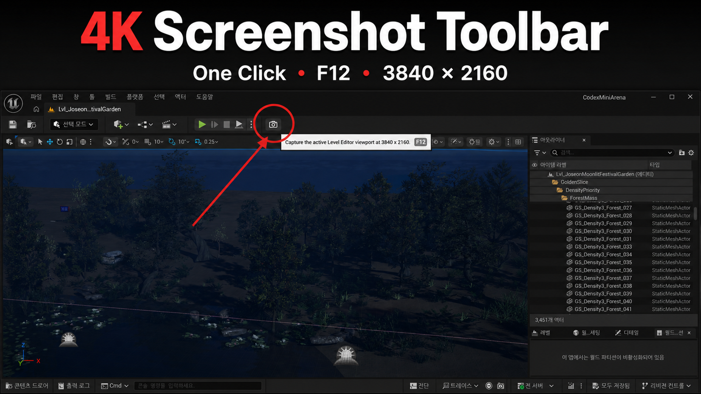

# 4K Screenshot Toolbar v1.0.1

This release expands verified Unreal Engine support and prepares the plugin for
free distribution on Fab.

## What's new

- Added an Unreal Engine 5.0 compatibility path for the Level Editor viewport API
- Verified independent Win64 plugin builds with Unreal Engine 5.0.3, 5.7.4, and 5.8.1
- Retained the one-click toolbar action and configurable F12 shortcut
- Added complete offline installation, usage, shortcut, and troubleshooting documentation
- Added Fab listing copy, compatibility notes, submission checklist, and a 1920 × 1080 thumbnail

## Downloads

Use the ZIP that matches the target Unreal Engine version:

- `HighResScreenshotToolbar-v1.0.1-UE5.0-Win64-Fab.zip`
- `HighResScreenshotToolbar-v1.0.1-UE5.7-Win64-Fab.zip`
- `HighResScreenshotToolbar-v1.0.1-UE5.8-Win64-Fab.zip`

Verify downloads with `SHA256SUMS.txt`.

## Installation

Extract the ZIP and copy the `HighResScreenshotToolbar` folder into either:

- `<Project>/Plugins/HighResScreenshotToolbar`, or
- `<Unreal Engine>/Engine/Plugins/Marketplace/HighResScreenshotToolbar`

Restart Unreal Editor and enable **4K Screenshot Toolbar** under
`Edit > Plugins` if needed.

## Compatibility note

Unreal Engine 5.5 is not advertised in this release because the available local
5.5.4 installation fails inside UnrealBuildTool before the plugin module is
compiled. This is recorded as a local engine/toolchain blocker rather than a
confirmed plugin source incompatibility.
