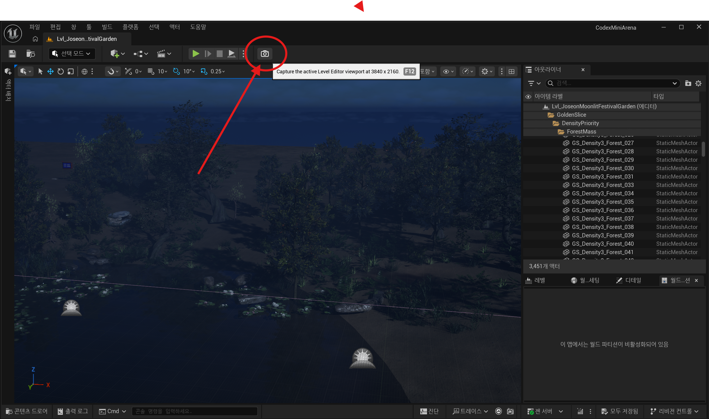

# Unreal Engine용 4K Screenshot Toolbar

[English README](README.md)

**4K Screenshot Toolbar**는 Unreal Editor의 활성 레벨 뷰포트를 고해상도
PNG로 저장해 주는 가벼운 에디터 플러그인입니다. 표준 해상도 프리셋을
고르거나 사용자 지정 크기를 입력한 뒤 **4K Shot** 버튼 또는 **F12**로 촬영합니다.



## 주요 기능

- 활성 Level Editor 뷰포트를 한 번에 고해상도로 캡처
- Full HD, QHD, Ultrawide QHD, 4K, 5K, 8K 프리셋 제공
- 64~16384 범위의 사용자 지정 너비와 높이 지원
- 기본 단축키 F12 제공 및 Unreal Editor에서 자유롭게 변경 가능
- 촬영 순간 Game View를 자동으로 적용해 에디터 아이콘과 기즈모 숨김
- 촬영이 끝나면 기존 뷰포트 상태 자동 복원
- Unreal Engine의 기본 스크린샷 완료 알림 사용
- 별도의 성공음이나 중복 성공 알림 없이 조용하게 동작
- Editor 전용 모듈로, 패키징된 게임에는 포함되지 않음

Windows Editor에서 스크린샷은 기본적으로 다음 폴더에 저장됩니다.

```text
<프로젝트>/Saved/Screenshots/WindowsEditor/
```

## 호환성

| Unreal Engine | Windows 검증 상태 |
| --- | --- |
| 5.9.0 MegaJam Preview (CL 60351404) | v1.2.0 F12 촬영 및 이미지 붙여넣기 확인 |
| 5.8.4 (CL 58902052) | v1.2.0 F12 촬영 및 이미지 붙여넣기 확인 |
| 5.8.1 | 독립 빌드 및 실제 기능 테스트 완료 |
| 5.7.4 | 독립 빌드 완료 |
| 5.5.4 | 독립 빌드 및 Editor 플러그인 로드 테스트 완료 |
| 5.0.3 | 독립 빌드 완료 |

5.8.1, 5.7.4, 5.5.4, 5.0.3 행은 이전 릴리스의 검증 결과입니다.
해당 버전용 Win64 패키지는 [v1.1.0 릴리스](https://github.com/fairypark/unreal-4k-screenshot-toolbar/releases/tag/v1.1.0)에서 받을 수 있습니다.

로컬 Unreal Engine 5.5.4에는 이 플러그인과 무관한 `VisualStudioTools` Rules
등록 문제가 있었습니다. 해당 엔진 플러그인만 제외한 정식 5.5
UnrealBuildTool에서 컴파일과 링크를 통과했고, Editor가 결과 플러그인을
정상적으로 마운트하는 것까지 확인했습니다.

## 설치 방법

1. [최신 릴리스](https://github.com/fairypark/unreal-4k-screenshot-toolbar/releases/latest)에서
   사용하는 엔진 버전에 맞는 ZIP을 내려받습니다.
2. 압축 안의 `HighResScreenshotToolbar` 폴더를 프로젝트의 `Plugins` 폴더에 넣습니다.

   ```text
   <프로젝트>/Plugins/HighResScreenshotToolbar/
   ```

3. 프로젝트를 엽니다.
4. 필요하면 `편집 > 플러그인`에서 **4K Screenshot Toolbar**를 활성화합니다.
5. 안내에 따라 에디터를 재시작합니다.

바로 설치 가능한 Win64 패키지는 검증된 Unreal Engine 버전별로 따로
제공되며 소스도 함께 포함합니다. 사용 중인 엔진 버전과 정확히 일치하는
ZIP을 사용하세요.

## 사용 방법

Level Editor 뷰포트를 활성화한 뒤 다음 중 하나를 실행합니다.

- 툴바의 **4K Shot** 버튼 클릭
- **F12** 누르기

Windows에서는 촬영할 때마다 이미지가 클립보드에도 복사됩니다.
AI 채팅 등 이미지를 붙여넣을 수 있는 앱에서 **Ctrl+V**를 누르세요.

저장 해상도를 바꾸려면
`편집 > 에디터 개인 설정 > 플러그인 > 4K Screenshot Toolbar`를 엽니다.
프리셋을 고르거나 `Custom`을 선택해 너비와 높이를 입력할 수 있습니다.
기본값은 `4K UHD (3840 x 2160)`이며 변경한 값은 에디터를 재시작하지 않아도
다음 촬영부터 바로 적용됩니다.

단축키를 바꾸려면 `편집 > 키보드 단축키` (`Ctrl+Alt+K`)를 열고
`4K Shot`을 검색해 원하는 키를 지정하면 됩니다.

전체 사용법과 문제 해결 방법은 [Documentation](Documentation.md)을 참고하세요.

## 라이선스

[MIT License](LICENSE)로 공개합니다.

Unreal Engine은 Epic Games, Inc.의 상표 또는 등록 상표입니다. 이 프로젝트는
Epic Games와 제휴하거나 Epic Games의 보증을 받은 프로젝트가 아닙니다.
