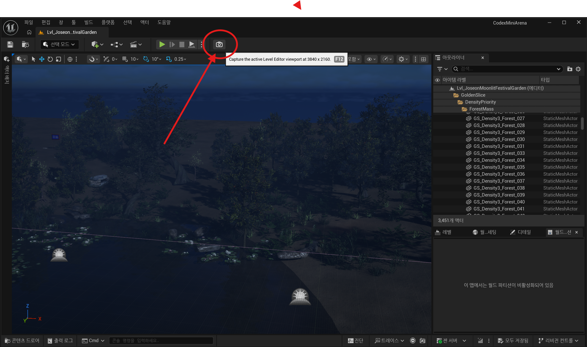

# 4K Screenshot Toolbar for Unreal Engine

[한국어 소개](README.ko.md)

A small, source-available Unreal Editor plugin that captures the active Level
Editor viewport as a high-resolution PNG. Choose a standard resolution preset
or enter a custom size, then use the **4K Shot** toolbar button or press **F12**.



## Features

- One-click high-resolution capture from the active Level Editor viewport
- Full HD, QHD, Ultrawide QHD, 4K, 5K, and 8K presets
- Custom width and height support from 64 to 16384 pixels
- F12 default shortcut, editable in Unreal Editor's Keyboard Shortcuts
- Temporarily enables Game View to hide editor icons and transform widgets
- Restores the viewport state automatically after capture
- Uses Unreal Engine's built-in screenshot completion notification
- Silent operation with no custom success sound or duplicate success toast
- Editor-only module; it is not included in packaged games

Screenshots are written to the project's platform-specific screenshot folder.
On Windows Editor, the default location is:

```text
<YourProject>/Saved/Screenshots/WindowsEditor/
```

## Compatibility

| Unreal Engine | Windows status |
| --- | --- |
| 5.9.0 Preview 2 (CL 60738873) | v1.2.0 Win64 build and Editor module load verified. F12 capture and paste pending |
| 5.9.0 MegaJam Preview (CL 60351404) | v1.2.0 F12 capture and image paste verified |
| 5.8.4 (CL 58902052) | v1.2.0 F12 capture and image paste verified |
| 5.8.1 | Build verified and functionally tested |
| 5.7.4 | Build verified |
| 5.5.4 | Build and Editor plugin load verified |
| 5.0.3 | Build verified |

The 5.8.1, 5.7.4, 5.5.4 and 5.0.3 rows describe earlier releases.
For their Win64 packages, see [v1.1.0](https://github.com/fairypark/unreal-4k-screenshot-toolbar/releases/tag/v1.1.0).

The local Unreal Engine 5.5.4 installation had an unrelated broken
`VisualStudioTools` rules registration. With that engine plugin excluded, the
stock 5.5 UnrealBuildTool compiled and linked this plugin successfully, and the
Editor mounted the resulting plugin.

## Installation

1. Download the ZIP matching your engine version from the
   [latest release](https://github.com/fairypark/unreal-4k-screenshot-toolbar/releases/latest).
2. Extract `HighResScreenshotToolbar` into your project's `Plugins` directory:

   ```text
   <YourProject>/Plugins/HighResScreenshotToolbar/
   ```

3. Open the project.
4. Enable **4K Screenshot Toolbar** in `Edit > Plugins` if it is not already enabled.
5. Restart the editor when requested.

Ready-to-install Win64 packages are built separately for each verified Unreal
Engine version and also include the source. Use the ZIP matching your exact
engine version.

## Usage

Activate the Level Editor viewport, then either:

- click **4K Shot** on the Level Editor toolbar, or
- press **F12**.

On Windows, each capture also copies the image to the clipboard. Press **Ctrl+V**
in an AI chat or another app that accepts pasted images.

To change the capture resolution, open
`Edit > Editor Preferences > Plugins > 4K Screenshot Toolbar`. Select a preset,
or choose `Custom` to enable the width and height fields. The default is
`4K UHD (3840 x 2160)`. Changes apply to the next capture without restarting
the editor.

To change the shortcut, open `Edit > Keyboard Shortcuts` (`Ctrl+Alt+K`), search
for `4K Shot`, and assign a different key.

For complete usage and troubleshooting details, see
[Documentation](Documentation.md).

## Notes

- The plugin captures only the active Level Editor viewport.
- A capture cannot start while another plugin capture is still being processed.
- If Game View was disabled, the plugin enables it only for the capture and
  restores the previous viewport state afterward.

## Building from source

Clone or copy this repository into your project's `Plugins` directory and
regenerate project files if your setup requires it. Build the Editor target for
your project using your installed Unreal Engine toolchain.

## License

Released under the [MIT License](LICENSE).

Unreal Engine is a trademark or registered trademark of Epic Games, Inc. This
project is not affiliated with or endorsed by Epic Games.
