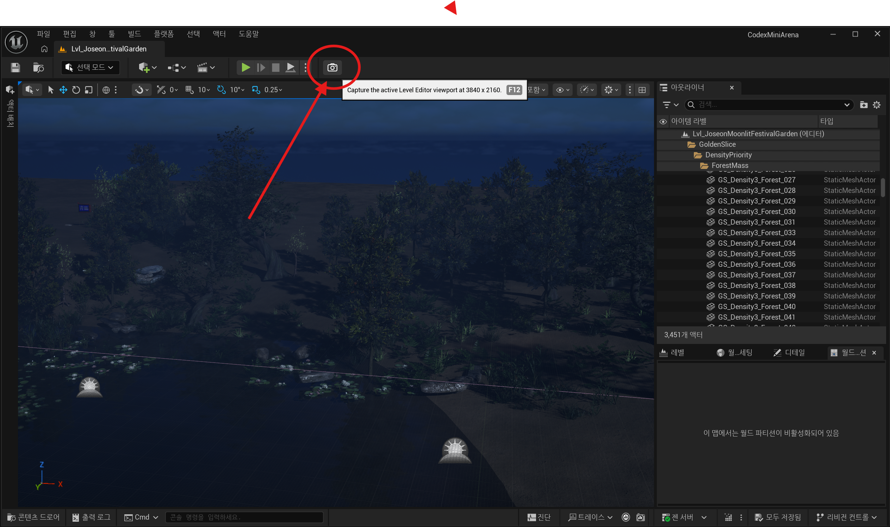

# Release Notes

## 4K Screenshot Toolbar v1.2.0

Press **F12** in the Level Editor, then **Ctrl+V** in an app that accepts images.
The **4K Shot** toolbar button uses the same workflow. Each capture also saves
its PNG in the project's screenshot folder. If Windows cannot copy the image,
the editor reports the clipboard failure and keeps the PNG.

Win64 downloads are available for Unreal Engine **5.9.0 MegaJam Preview (CL 60351404)** and
**5.8.4 (CL 58902052)**. Choose the ZIP matching your editor build and
extract the `HighResScreenshotToolbar` folder into your project's `Plugins`
directory. Builds for UE 5.0, 5.5 and 5.7 are available in release v1.1.0.

## 4K Screenshot Toolbar v1.1.0

Choose Full HD, QHD, Ultrawide QHD, 4K UHD, 5K, or 8K UHD from Editor
Preferences, or select `Custom` and enter an exact width and height. Both the
toolbar button and F12 shortcut use the saved setting. 4K UHD remains the
default.

Verified independent Win64 plugin builds:

- Unreal Engine 5.8.1
- Unreal Engine 5.7.4
- Unreal Engine 5.5.4
- Unreal Engine 5.0.3

## 4K Screenshot Toolbar v1.0.0

Capture a clean 4K image from the active Unreal Editor viewport with one click
or F12.

Unreal Editor에서 버튼 한 번 또는 F12로 활성 뷰포트의 깔끔한 4K 이미지를
저장할 수 있는 작은 오픈소스 플러그인입니다.



## Highlights

- Exact 3840 × 2160 PNG capture
- **4K Shot** Level Editor toolbar button
- Configurable F12 keyboard shortcut
- Automatic Game View switching for clean captures
- Automatic viewport-state restoration
- No custom sound or duplicate success notification
- Editor-only module; packaged games are unaffected

## Compatibility

- Tested: Unreal Engine 5.8 / Windows
- License: MIT

## Installation

Download `HighResScreenshotToolbar-v1.0.0-UE5.8-Win64.zip`, extract the
`HighResScreenshotToolbar` folder into `<YourProject>/Plugins/`, and restart
Unreal Editor.

Screenshots are saved under:

```text
<YourProject>/Saved/Screenshots/WindowsEditor/
```

For complete instructions, shortcut customization, and source-build guidance,
see the English and Korean README files in the repository.
